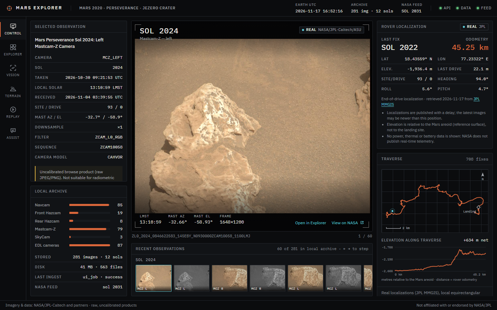
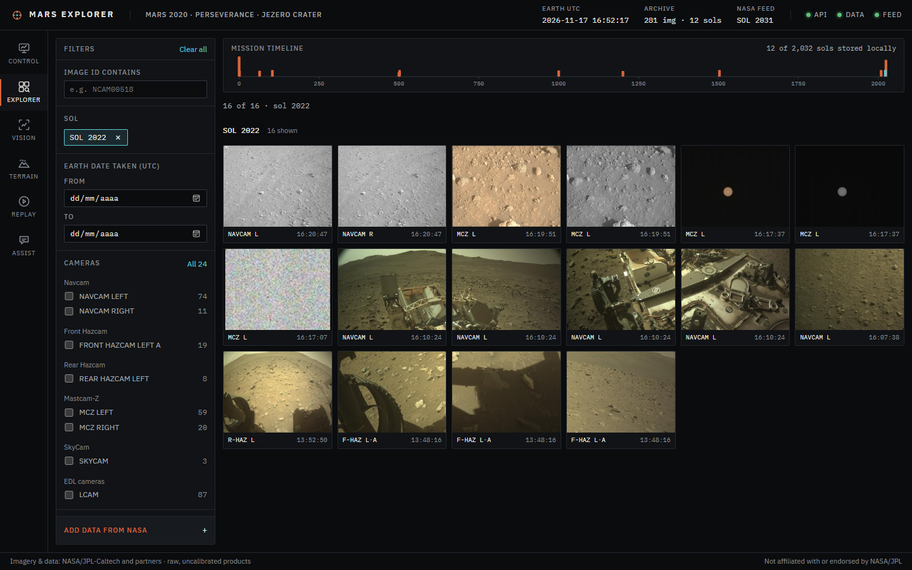
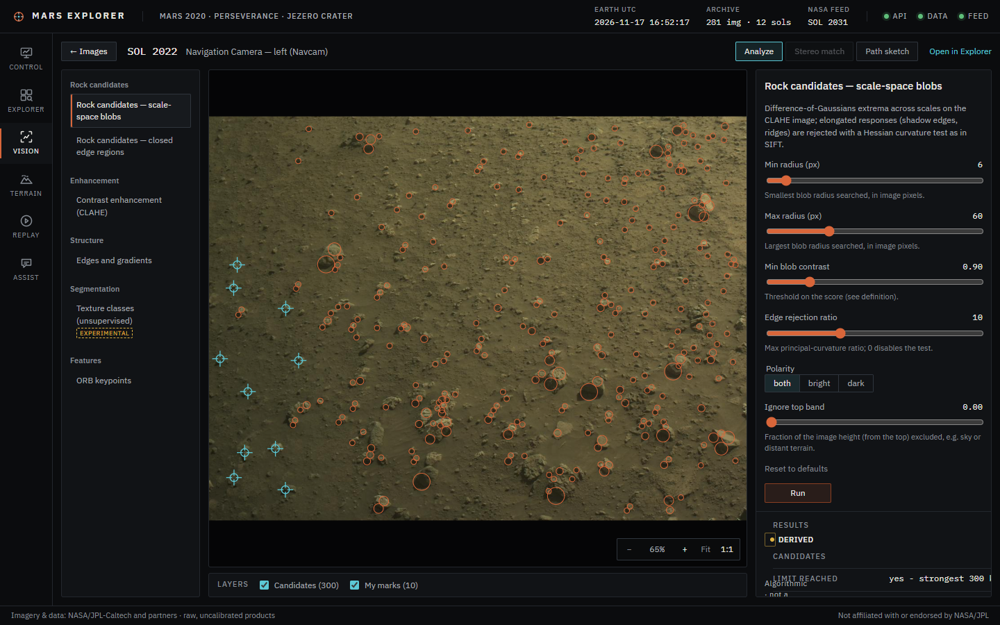
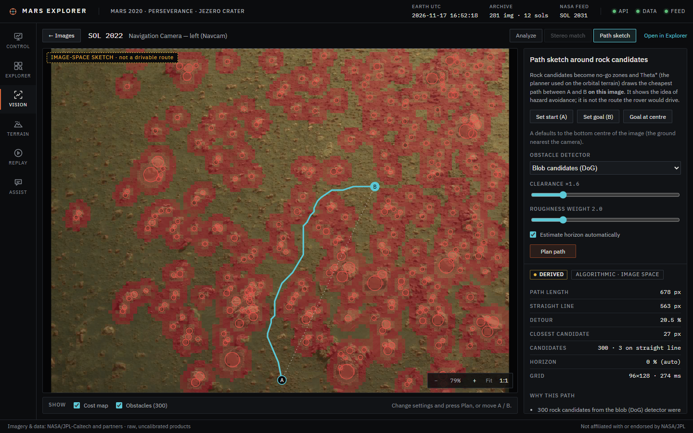
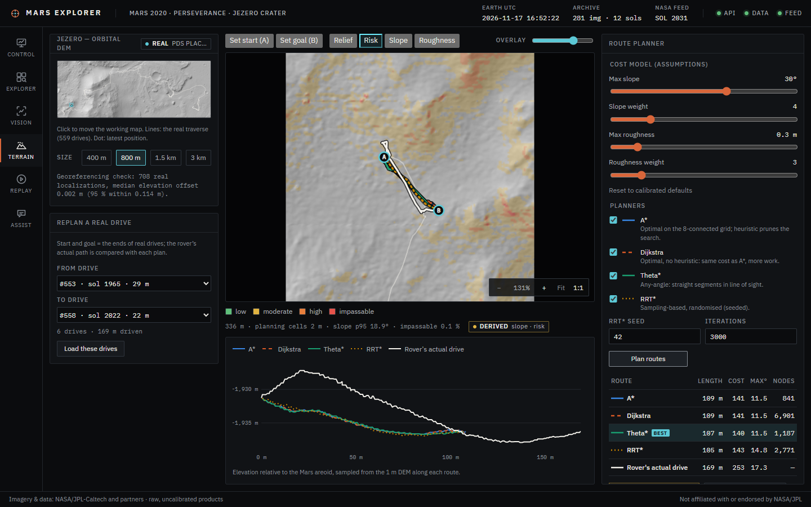
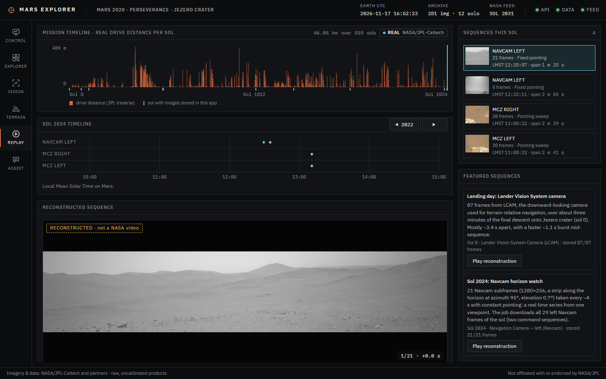
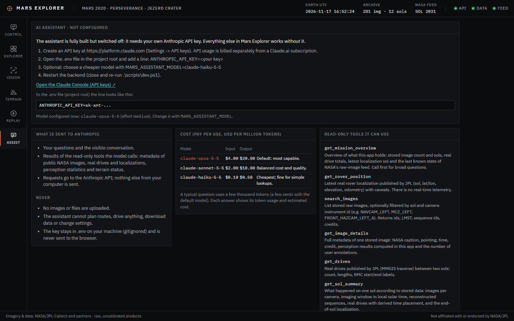

# Mars Explorer

A mission-control style web app for exploring **real NASA Mars 2020 Perseverance data**:
raw rover imagery, real localizations and drive paths, computer vision, cost maps on a 1 m
orbital elevation model, explainable route planning, a sol-by-sol mission replay and an optional,
read-only AI assistant — built to be **honest about what the data can and cannot say**.

> Imagery & data: NASA/JPL-Caltech and partners. Not affiliated with or endorsed by NASA/JPL.



**Read the [case study](docs/CASE_STUDY.md)** for the design decisions, results on real data and
the problems found along the way.

## What you can do

| | |
|---|---|
|  | **Explorer** — filter the archive by sol and camera, zoom, verified stereo pairs, side-by-side / swipe comparison, download more data from the UI. |
|  | **Perception** — classical CV on raw frames (CLAHE, edges, two rock-candidate detectors, texture, ORB stereo matching), every result labelled by method and scored against your own marks. |
|  | **Path sketch** — click a goal on an image and a deterministic planner (Theta*) draws a path around the detected rock candidates. Stamped *image-space sketch · not a drivable route*. |
|  | **Terrain & Navigation** — slope, roughness and risk from the 1 m PDS orbital DEM; A*, Dijkstra, Theta* and RRT* compared with the rover's real drive, with explanations. |
|  | **Mission Replay** — real drive distance per sol, LMST timelines, frame sequences reconstructed from raw images (labelled as such) and official NASA videos. |
|  | **AI assistant (optional)** — Claude with 8 read-only tools over the app's data. Off until you add your own API key; it can explain, never act. |

## Principles

- **Real and traceable.** Every record keeps its original NASA metadata and credit; every
  object carries a provenance label: `real_observation`, `derived`, `simulated` or `user_generated`.
- **Honest limits.** Raw images are uncalibrated browse products; nothing is measured from a
  single 2D photo; no fake telemetry (NASA publishes no real-time power/thermal data).
- **Deterministic autonomy.** Route planning uses explainable algorithms on a defined cost map.
  A language model never controls the rover.

## Status

| Phase | Scope | State |
|---|---|---|
| 0 | Environment, repository, architecture | done |
| 1 | Ingestion pipeline, REST API, Mission Control UI | done |
| 2 | Explorer: filters, zoom viewer, stereo pairs, comparison, chronology, UI ingestion | done |
| 3 | Perception: CLAHE, edges, 2 rock-candidate detectors, texture, ORB stereo matching, human-annotation evaluation, benchmark | done |
| 4 | Real 1 m orbital DEM, calibrated cost maps, A* / Dijkstra / Theta* / RRT* compared with the rover's real drives | done |
| 5 | Mission replay (sol timelines, reconstructed sequences, official NASA videos) + optional AI assistant | done |
| 6 | Image-space path sketch, E2E + accessibility tests (Playwright, axe), error boundaries, case study | **done** |

## Architecture

```
Browser ── Vite (React 19 + TS, :5173) ──/api──▶ FastAPI (:8000)
                                                   ├─ ingest/      NASA raw-images feed, JPL MMGIS, jobs
                                                   ├─ vision/      classical CV + image-space path sketch
                                                   ├─ terrain/     PDS 1 m DEM (memmap), cost layers
                                                   ├─ navigation/  A*, Dijkstra, Theta*, RRT*
                                                   ├─ replay/      sequences, SCLK→LMST timelines, videos
                                                   ├─ assistant/   optional Claude tool loop (read-only)
                                                   └─ db/          SQLite + local image cache (data/)
```

See [docs/ARCHITECTURE.md](docs/ARCHITECTURE.md) for decisions and trade-offs and
[docs/api/contract-v1.md](docs/api/contract-v1.md) for the API contract (v1 → v1.5).

## Quick start (Windows, PowerShell)

Prerequisites: Git, [uv](https://docs.astral.sh/uv/), Node.js 26 LTS. Full beginner guide:
[docs/SETUP.md](docs/SETUP.md) (in Spanish).

```powershell
.\scripts\setup.ps1 -Seed   # install dependencies + download ~13 MB of real data
.\scripts\dev.ps1           # start API + UI and open http://localhost:5173
.\scripts\check.ps1         # lint, type-check, tests and build
.\scripts\check.ps1 -E2E    # + browser end-to-end and accessibility tests (Microsoft Edge)
```

Portfolio screenshots of your own running app: `cd frontend; npm run screenshots` → `docs/media/`.

Perception benchmark (writes [docs/benchmarks/perception-benchmark.md](docs/benchmarks/perception-benchmark.md)):

```powershell
cd backend; uv run mars-vision benchmark
```

Engineering notes and real-data findings: [docs/CASE_STUDY.md](docs/CASE_STUDY.md), [docs/perception.md](docs/perception.md),
[docs/terrain-navigation.md](docs/terrain-navigation.md), [docs/replay-assistant.md](docs/replay-assistant.md).

Optional AI assistant: add `ANTHROPIC_API_KEY=<key>` to `.env` and restart the backend
(details and costs in the Assistant page and in docs/replay-assistant.md). Without a key the
assistant stays off and everything else works.

Terrain (one-time, ~325 MB from NASA PDS):

```powershell
cd backend; uv run mars-terrain fetch; uv run mars-terrain status
```

Ingest more data:

```powershell
cd backend
uv run mars-ingest images --sol 1201 --camera NAVCAM_LEFT --camera MCZ_LEFT --limit 30
uv run mars-ingest waypoints
uv run mars-ingest status
```

API documentation (OpenAPI) is served at http://127.0.0.1:8000/docs while the backend runs.

## Data sources (verified 2026-11-16)

| Source | Used for | Notes |
|---|---|---|
| NASA Mars 2020 raw-images JSON feed (`mars.nasa.gov/rss/api`) | images + metadata | undocumented; parsed defensively; ≤100 per page |
| JPL MMGIS `M20_waypoints.json` | real rover localizations | `-9999` and mid-drive `0.0` odometry treated as missing |
| JPL MMGIS `M20_traverse.json` | real drive paths (~1 m vertices) | replanning endpoints and comparison |
| PDS PLACES `m20_orbital_dem` | 1 m orbital DEM (324.5 MB) | georeferencing validated against 708 localizations (median 0.002 m) |
| NASA Image and Video Library | 3 official videos (landing, Ingenuity) | allowlist, https assets verified live, streamed not stored |
| `api.nasa.gov/mars-photos` | — | **discontinued (HTTP 404)**; not used |

Feed quirks handled: a literal `|` in the query → HTTP 400; an unknown `id=` silently returns the
generic latest list (HTTP 200); stereo partners (`NLG_…` ↔ `NRG_…`) are verified before use.

Details: [docs/research/2026-11-16-data-sources-and-toolchain.md](docs/research/2026-11-16-data-sources-and-toolchain.md).

## Tech stack

Python 3.13 · FastAPI · SQLModel/SQLite · httpx · OpenCV · NumPy · Anthropic SDK · pytest · ruff — TypeScript ·
React 19 · Vite · Vitest · Testing Library · Playwright · axe-core · oxlint. No UI framework; custom design system in `frontend/src/design-system`.
