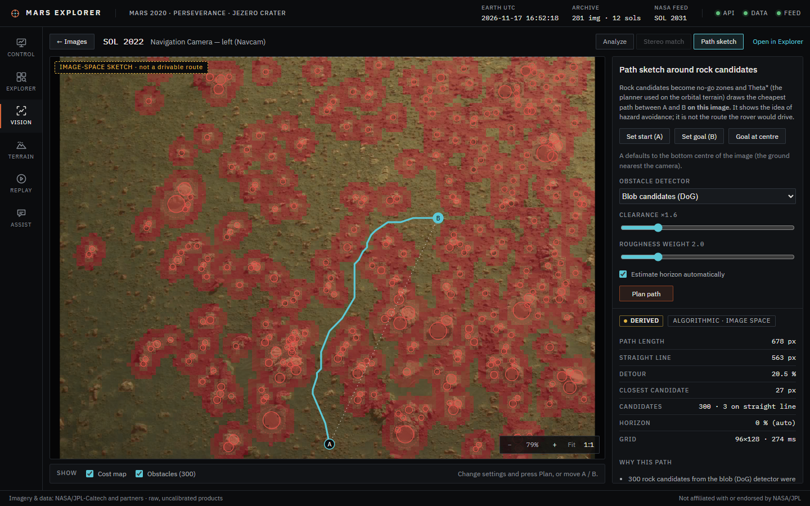

# Case study — Mars Explorer

*A mission-control web app on real NASA Perseverance data, built to be honest about what the
data can and cannot say.*



## The problem

Mars data is public, but in pieces:

- an undocumented raw-image feed;
- rover localizations and drive paths in a mapping tool's JSON;
- a 1 m orbital elevation model on the Planetary Data System;
- videos in a separate library.

Each source has its own quirks and units, and none of it says what is real, what is derived and what is a guess.

The goal was a portfolio-grade application that brings these sources together:

- for exploration: browse images and see where the rover went;
- for experiments: computer vision on real frames, and route planning on real terrain compared
  with the rover's actual drives;
- for storytelling: a sol-by-sol replay and an optional AI assistant.

The application had to stay scientifically honest throughout.

## Constraints I set myself

1. **Every object carries provenance.** Each one is labelled `real_observation`, `derived`,
   `simulated` or `user_generated`, and the UI always shows a badge.
2. **No fake telemetry.** NASA publishes no real-time power or thermal data, so the app shows
   none.
3. **No measurements from a single raw image.** These are uncalibrated browse products with no
   scale.
4. **A language model never controls navigation.** Planning is deterministic and explains
   itself.
5. **Reconstructed frame sequences are labelled as such**, never presented as a "NASA video".

These rules shaped more design decisions than any framework choice.

## Architecture

A **modular monolith** with one FastAPI service and one React app, split into modules that have
explicit interfaces:

```
React 19 + TypeScript (Vite) ──/api──▶ FastAPI
  design-system/   tokens, primitives        ingest/      NASA feed, MMGIS, downloader, jobs
  modules/         7 screens                 vision/      classical CV, path sketch
  api/             typed client (contract)   terrain/     1 m DEM (memmap), cost layers
                                             navigation/  A*, Dijkstra, Theta*, RRT*
                                             replay/      sequences, SCLK→LMST timelines
                                             assistant/   optional Claude tool loop (read-only)
                                             db/          SQLite (SQLModel)
```

- **Contract-first API.** `docs/api/contract-v1.md` went through versions v1 to v1.5, and the
  TypeScript types mirror the Pydantic schemas.
- **Local-first data.** Images are cached and served through the backend, because NASA's image
  files send no CORS headers. Without that, pixels could not be drawn on a canvas.

## What was built

| Module | What it does | What makes it honest |
|---|---|---|
| Mission Control | latest real images, rover localization, archive status | each item's own NASA credit; localization caveats |
| Explorer | filters, zoom viewer, verified stereo pairs, comparison, background ingest jobs | stereo partner verified before being called a pair |
| Perception | CLAHE, edges, 2 rock-candidate detectors, texture, ORB stereo matching | method labelled; scores defined (not probabilities); evaluated against the user's own marks |
| Path sketch | A→B route drawn on an image around rock candidates (Theta*) | stamped "image-space sketch · not a drivable route"; pixels, not metres |
| Terrain & Navigation | 1 m orbital DEM, slope/roughness/risk, 4 planners compared with the rover's real drive | assumptions editable and listed; limitations stated |
| Mission Replay | drive distance per sol, LMST timelines, reconstructed sequences, official NASA videos | "reconstructed" vs "official NASA video" labels; derived time placement stated with its residual |
| AI assistant | Claude with 8 read-only tools over app data | off without a key; cannot plan or act; every answer labelled AI-generated with its tool calls |

## Results on real data

- **Georeferencing.**
  - Lon/lat → DEM projection agrees with JPL's own easting/northing to within 1 mm.
  - All 708 real localizations fall inside the DEM, with a median elevation offset of 0.002 m.
- **Replanning real drives** (sols 1965 → 2022, 169 m driven):
  - The planners find routes of about 107 m with a maximum slope of 11.5°.
  - A* expands 8.2× fewer nodes than Dijkstra for the same optimum.
  - The rover's real path went over a 17.3° crest. It was serving science and operations goals
    that a cost map cannot see.
- **Calibration check.** Over sols 1000 → 1018, the rover's real path never crosses a cell that
  the model calls impassable.
- **Perception.**
  - The two independent rock detectors agree with a median F1 of only 0.37 over 40 images, so
    neither one is "the truth". That result is why the app has an annotation and evaluation tool.
  - The stereo pair on sol 2022 keeps 704 of 905 ORB matches after RANSAC, with a vertical
    offset of 5 ± 1 px.
- **Replay.**
  - The SCLK → LMST placement of drives agrees with the published image times to within
    0.9–2.0 s.
  - The landing LCAM sequence has 87 frames over 187 s.

## Problems worth telling

1. **The image feed returned HTTP 400 for valid queries.**
   - Cause: the multi-camera filter uses `|`, and building the URL by hand sent it unencoded.
   - Fix: query parameters always go through the HTTP client's parameter encoding.
2. **An unknown image id returned HTTP 200.**
   - The feed silently returns the generic latest list instead of an error.
   - Stereo-partner lookups now match the returned `imageid` before trusting the response.
3. **A zig-zag elevation profile.**
   - Mid-drive localizations report cumulative odometry as `0.0`, not as missing.
   - They are now treated as missing.
4. **Straight lines between localizations lied.**
   - One straight segment crossed a 34.6° cell that the rover never drove on.
   - The fix was to ingest JPL's dense traverse, with vertices about 1 m apart.
5. **Shadow edges looked like rocks.**
   - The rover's shadow boundary triggered the blob detector.
   - A SIFT-style Hessian test removes elongated responses; a synthetic scene with known ground
     truth proves it.
6. **Performance.**
   - Quadratic non-maximum suppression with permissive parameters took minutes. A grid-based
     version with early stop brings it to about 170 ms.
   - RRT* became O(n²) on small maps. k-nearest rewiring and a profiled hot path took the test
     scenario from 27.7 s to 2.6 s.
7. **Benchmark noise was really CPU topology.**
   - The same detector took 157 ms on performance cores and 342 ms on efficiency cores.
   - I first blamed background load. A process-affinity experiment showed the real cause.
8. **A description written from a partial listing.**
   - A featured sequence was first described with the cadence of a different sequence from the
     same sol.
   - Descriptions now come from the stored records, and a live test asserts the frame counts.

## Quality

- **Backend:** 187 tests with pytest. They run offline against **real captured NASA
  responses** and synthetic scenes with known ground truth. Live tests (opt-in) detect upstream
  format changes.
- **Frontend:** 83 tests with Vitest and Testing Library.
- **End-to-end:** 14 Playwright tests in Microsoft Edge, run on an isolated, offline-seeded
  backend:
  - every module, the path sketch with a real click, and sequence playback;
  - **axe accessibility checks** with no serious or critical WCAG 2.1 AA violations. Fixing
    them raised the muted text colour to at least 4.5:1 contrast.
- **The AI assistant** is tested with the real Anthropic SDK against a mocked HTTP transport.
  The exact request bodies, the refusal handling and the error mapping are asserted without a
  key.
- **One command runs everything:** `scripts/check.ps1` (ruff, pytest, oxlint, tsc, Vitest,
  build, plus `-E2E` and `-Live`).

## Limitations and next steps

- **Distances from images.** Metric distances need the CAHVORE camera models and stereo
  triangulation. That is the natural next step for the path sketch, turning it into a real
  local hazard map.
- **Learned perception.** Learned segmentation, for example trained on AI4Mars, should be
  evaluated against Perseverance annotations made with the built-in tool before it is trusted.
- **Wider planning.** Planning ignores vehicle footprint, heading, wheel–soil interaction, time
  and science goals.

*Imagery and data: NASA/JPL-Caltech and partners. Not affiliated with or endorsed by NASA/JPL.*
